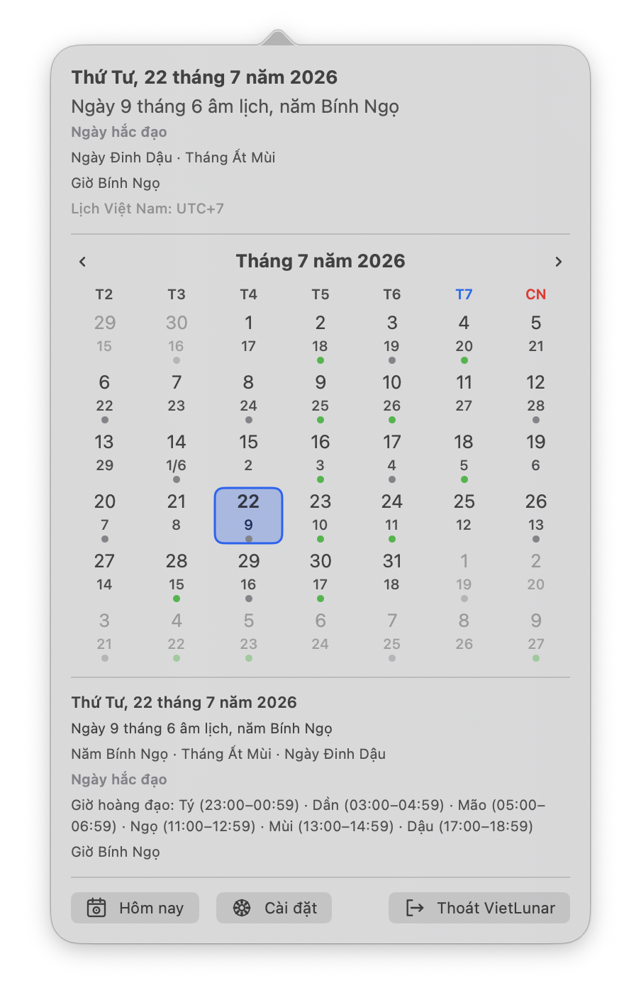

# VietLunar

[](https://github.com/bravohex/viet-lunar/actions/workflows/ci.yml)
[](https://github.com/bravohex/viet-lunar/actions/workflows/release.yml)

Lịch âm Việt Nam gọn nhẹ, riêng tư và luôn sẵn trên thanh menu của macOS.

<p align="center">
  
</p>

VietLunar là ứng dụng macOS native chạy hoàn toàn trên máy. Ứng dụng không cần tài khoản, không cần kết nối mạng và không có thư viện runtime bên thứ ba.

[Tải bản phát hành mới nhất](https://github.com/bravohex/viet-lunar/releases) · [Giấy phép MIT](LICENSE)

## Tính năng

- Xem lịch tháng dương và ngày âm Việt Nam ngay từ thanh menu.
- Hiển thị Can–Chi của năm, tháng, ngày và giờ; kèm giờ hoàng đạo và phân loại ngày.
- Tùy chỉnh nội dung thanh menu, đồng hồ, ngày bắt đầu tuần và quy ước đổi ngày Can–Chi.
- Hiển thị ngày lễ Việt Nam: số ngày lễ chính thức đổi sang màu đỏ và có chấm đỏ dưới ô (ngày kỷ niệm có vòng tròn cam), tên ngày lễ hiện ở phần chi tiết ngày được chọn. Có thể nhập tệp `.ics` của quốc gia khác.
- Có thể mở VietLunar cùng lúc đăng nhập macOS.
- Hỗ trợ VoiceOver và điều hướng bằng bàn phím.

## Cài đặt

1. Tải tệp ZIP ở [bản phát hành mới nhất](https://github.com/bravohex/viet-lunar/releases).
2. Giải nén rồi kéo `VietLunar.app` vào thư mục `Applications`.
3. Mở VietLunar. Biểu tượng lịch âm sẽ xuất hiện trên thanh menu.

Nếu macOS yêu cầu xác nhận ở lần mở đầu tiên, hãy làm theo hướng dẫn hiển thị trên máy.

## Phạm vi lịch

- Hỗ trợ ngày dương từ **01/01/1800** đến **31/12/2199**.
- Ngày âm và Can–Chi được tính theo quy ước múi giờ **UTC+7**.
- Kết quả từ năm 1800 đến 1975 là lịch Việt Nam hiện đại suy rộng, không phải bản phục dựng lịch chính thức cho mọi vùng và giai đoạn lịch sử.

## Ngày lễ

- Dữ liệu mặc định là tệp [`App/Resources/Holidays/vietnam.ics`](App/Resources/Holidays/vietnam.ics). Khi cần cập nhật (năm mới, ngày nghỉ bù, ngày lễ mới), chỉ cần thay tệp này bằng bản mới, giữ nguyên tên, rồi build lại; mã nguồn không phụ thuộc vào nội dung hay năm của tệp.
- Người dùng có thể vào **Cài đặt > Ngày lễ > Nhập tệp .ics…** để thêm một hoặc nhiều tệp. Có thể nhập nhiều nguồn nhưng mỗi lúc chỉ hiển thị một nguồn (hoặc không hiển thị).
- Định dạng được hỗ trợ: sự kiện cả ngày (`DTSTART` dạng ngày, `DTEND` không tính ngày cuối), lặp hằng năm đơn giản (`RRULE:FREQ=YEARLY` với `INTERVAL`, `COUNT`, `UNTIL`). Sự kiện có giờ và quy tắc lặp phức tạp bị bỏ qua.
- Sự kiện có `DESCRIPTION` chứa “observance” được xem là ngày kỷ niệm và mặc định bị ẩn; các sự kiện còn lại là ngày lễ chính thức.
- Giới hạn: tối đa 1 MB mỗi tệp và năm từ 1800 đến 2199.

## Quyền riêng tư

VietLunar hoạt động offline. Ứng dụng chỉ lưu các tùy chọn hiển thị và các tệp ngày lễ `.ics` do bạn nhập trên máy Mac của bạn; không thu thập analytics, không hiển thị quảng cáo và không gửi dữ liệu cá nhân ra ngoài thiết bị. Xem [chính sách quyền riêng tư](PRIVACY.md).

## Phát triển

Yêu cầu: macOS 13 trở lên và Xcode có hỗ trợ Swift 6.

```bash
git clone https://github.com/bravohex/viet-lunar.git
cd viet-lunar
open VietLunar.xcodeproj
```

Chọn scheme **VietLunar** trong Xcode rồi nhấn Run. Để build, cài bản Debug vào `~/Applications` và mở ứng dụng bằng một lệnh:

```bash
./scripts/install.sh
```

Chạy bộ kiểm tra chức năng:

```bash
./scripts/test.sh --skip-performance
```

Sau khi thêm hoặc xóa tệp nguồn, tái tạo project Xcode trước khi build:

```bash
ruby Tools/ProjectGenerator/generate_project.rb
```

## Đóng góp

Đóng góp qua issue hoặc pull request đều được chào đón. Trước khi gửi pull request, hãy chạy bộ kiểm tra ở trên và mô tả rõ thay đổi ảnh hưởng đến cách tính lịch hoặc giao diện.

## Giấy phép

Copyright © 2026 bravohex. Phát hành theo [MIT License](LICENSE).
