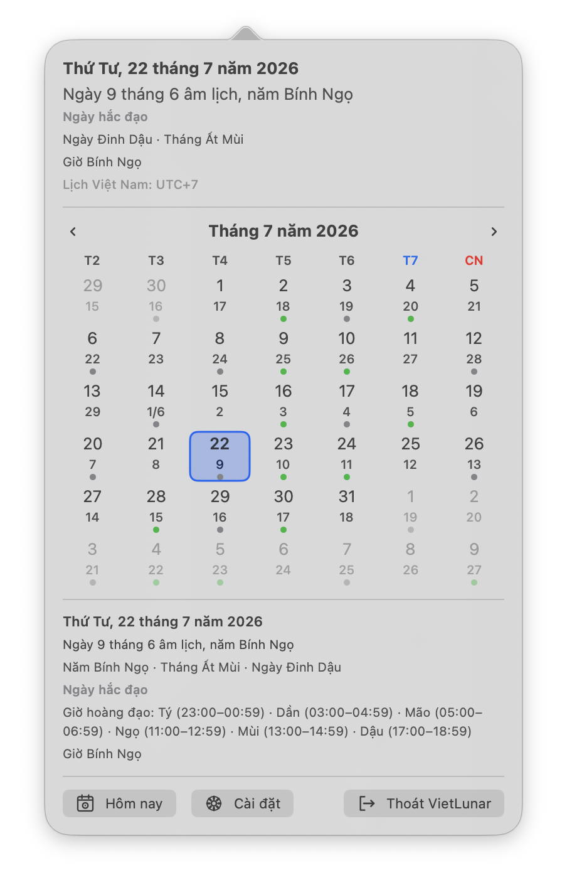

# VietLunar

[](https://github.com/bravohex/viet-lunar/actions/workflows/ci.yml)
[](https://github.com/bravohex/viet-lunar/actions/workflows/release.yml)

Lịch âm Việt Nam gọn nhẹ, riêng tư và luôn sẵn trên thanh menu của macOS.

<p align="center">
  
</p>

VietLunar là ứng dụng macOS native chạy hoàn toàn trên máy. Ứng dụng không cần tài khoản, không cần kết nối mạng và không có thư viện runtime bên thứ ba.

[Tải bản phát hành mới nhất](https://github.com/bravohex/viet-lunar/releases) · [Mã nguồn: MIT](LICENSE) · [Dữ liệu ngày lễ: CC BY-SA 3.0](Tools/Holidays/README.md#attribution-and-license)

## Tính năng

- Xem lịch tháng dương và ngày âm Việt Nam ngay từ thanh menu.
- Hiển thị Can–Chi của năm, tháng, ngày và giờ; kèm giờ hoàng đạo và phân loại ngày.
- Tùy chỉnh nội dung thanh menu, đồng hồ, ngày bắt đầu tuần và quy ước đổi ngày Can–Chi.
- Hiển thị ngày lễ Việt Nam: số ngày lễ chính thức đổi sang màu đỏ và có chấm đỏ dưới ô (ngày kỷ niệm có vòng tròn cam), tên ngày lễ hiện ở phần chi tiết ngày được chọn. Có thể nhập tệp `.ics` của quốc gia khác.
- Có thể mở VietLunar cùng lúc đăng nhập macOS.
- Hỗ trợ VoiceOver và điều hướng bằng bàn phím.
- Icon ứng dụng, menu bar và giao diện dùng [Lucide](Tools/Icons/README.md), đóng gói sẵn để hoạt động offline.

## Cài đặt

1. Tải tệp ZIP ở [bản phát hành mới nhất](https://github.com/bravohex/viet-lunar/releases).
2. Giải nén rồi kéo `VietLunar.app` vào thư mục `Applications`.
3. Mở VietLunar. Biểu tượng lịch âm sẽ xuất hiện trên thanh menu.

Nếu macOS yêu cầu xác nhận ở lần mở đầu tiên, hãy làm theo hướng dẫn hiển thị trên máy.

## Phạm vi lịch

- Hỗ trợ ngày dương từ **01/01/1800** đến **31/12/2199**.
- Ngày âm và Can–Chi được tính theo quy ước múi giờ **UTC+7**.
- Kết quả từ năm 1800 đến 1975 là lịch Việt Nam hiện đại suy rộng, không phải bản phục dựng lịch chính thức cho mọi vùng và giai đoạn lịch sử.

## Ngày lễ

- Dữ liệu mặc định trong [`App/Resources/Holidays/vietnam.ics`](App/Resources/Holidays/vietnam.ics) bao phủ **2000–2050**, sinh từ bộ quy tắc Việt Nam của `date-holidays`; các ngày âm lịch được tính riêng từng năm. [Bộ sinh dữ liệu và nguồn cố định](Tools/Holidays/README.md) cho phép tái tạo và kiểm tra file trước mỗi bản phát hành.
- Đây là lịch lễ và ngày kỷ niệm, **không phải lịch nghỉ làm áp dụng cho mọi người**. Giữ kỳ nghỉ Tết 5 ngày theo quy tắc nguồn: từ giao thừa đến hết mùng 4, với tên riêng “Kỳ nghỉ tết Nguyên đán”; lịch nghỉ thực tế có thể khác theo từng năm và đơn vị. Không tự thêm ngày nghỉ bù, ngày nghỉ Quốc khánh liền kề hay ngày hoán đổi. Các lịch nghỉ cụ thể cần tệp riêng theo thông báo từng năm và đối tượng áp dụng.
- Mốc hiệu lực có trong nguồn được giữ nguyên (ví dụ Ngày Văn hóa Việt Nam từ 2026). Những quy tắc không có mốc bắt đầu được suy rộng vào quá khứ; dữ liệu không phục dựng đầy đủ lịch sử ngày lễ. Các năm tương lai theo bộ quy tắc tại thời điểm cập nhật và có thể thay đổi.
- Người dùng có thể vào **Cài đặt > Ngày lễ > Nhập tệp .ics…** để thêm một hoặc nhiều tệp. Có thể nhập nhiều nguồn nhưng mỗi lúc chỉ hiển thị một nguồn (hoặc không hiển thị).
- Vào **Cài đặt > Ngày lễ > Quản lý tệp ICS…** để xóa từng nguồn đã nhập, kể cả nguồn không đang dùng. Có bước xác nhận; chỉ bản sao trong VietLunar bị xóa, tệp gốc vẫn còn. Xóa nguồn đang dùng sẽ chuyển về lịch Việt Nam mặc định; nguồn mặc định không thể xóa.
- Cập nhật app chỉ cập nhật lịch mặc định; tệp đã nhập và nguồn đang chọn được giữ nguyên. Chọn lại lịch mặc định trong Cài đặt nếu đang dùng một tệp cũ chỉ có một năm.
- Nguồn ngày lễ và khoảng năm của tệp nằm trong Cài đặt. Nếu năm đang xem không có sự kiện, popover và Cài đặt cùng cảnh báo để bạn chọn nguồn khác; cảnh báo cũng áp dụng khi tệp bị thiếu một năm ở giữa khoảng dữ liệu.
- Định dạng được hỗ trợ: sự kiện cả ngày (`DTSTART` dạng ngày, `DTEND` không tính ngày cuối), lặp hằng năm đơn giản (`RRULE:FREQ=YEARLY` với `INTERVAL`, `COUNT`, `UNTIL`). Sự kiện có giờ và quy tắc lặp phức tạp bị bỏ qua.
- Ngày loại trừ `EXDATE` dạng ngày được áp dụng sau khi tính lịch lặp; sự kiện có `STATUS:CANCELLED` không được hiển thị. Sự kiện chứa ngày loại trừ không hợp lệ bị bỏ qua.
- Có thể dùng `DURATION:P3D` (3 ngày) hoặc `DURATION:P2W` (2 tuần) thay cho `DTEND`, tối đa 31 ngày. Khoảng thời gian không hợp lệ, vượt giới hạn hoặc khai báo đồng thời với `DTEND` bị bỏ qua.
- Sự kiện có `DESCRIPTION` chứa “observance” được xem là ngày kỷ niệm và mặc định bị ẩn; các sự kiện còn lại là ngày lễ chính thức.
- Giới hạn: tối đa 1 MB mỗi tệp và năm từ 1800 đến 2199.

## Quyền riêng tư

VietLunar hoạt động offline. Ứng dụng chỉ lưu các tùy chọn hiển thị và các tệp ngày lễ `.ics` do bạn nhập trên máy Mac của bạn; không thu thập analytics, không hiển thị quảng cáo và không gửi dữ liệu cá nhân ra ngoài thiết bị. Xem [chính sách quyền riêng tư](PRIVACY.md).

## Phát triển

Yêu cầu: macOS 13 trở lên và Xcode có hỗ trợ Swift 6.

```bash
git clone https://github.com/bravohex/viet-lunar.git
cd viet-lunar
open VietLunar.xcodeproj
```

Chọn scheme **VietLunar** trong Xcode rồi nhấn Run. Để build, cài bản Debug vào `~/Applications` và mở ứng dụng bằng một lệnh:

```bash
./scripts/install.sh
```

Chạy bộ kiểm tra chức năng:

```bash
./scripts/test.sh --skip-performance
```

Sau khi thêm hoặc xóa tệp nguồn, tái tạo project Xcode trước khi build:

```bash
ruby Tools/ProjectGenerator/generate_project.rb
```

## Đóng góp

Đóng góp qua issue hoặc pull request đều được chào đón. Trước khi gửi pull request, hãy chạy bộ kiểm tra ở trên và mô tả rõ thay đổi ảnh hưởng đến cách tính lịch hoặc giao diện.

## Giấy phép

Copyright © 2026 bravohex. Phát hành theo [MIT License](LICENSE).

Số đo hiệu năng local gần nhất và giới hạn của phép đo: [báo cáo ngày 06/11/2026](docs/performance-2026-11-06.md).
