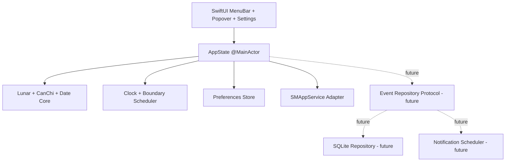

# VietLunar for macOS — Product & Technical Specification

**Status:** Implementation-ready draft 1.0  
**Date:** 2026-07-20  
**Working product name:** `VietLunar` — renameable before distribution  
**Primary audience:** Codex / implementation agent, reviewer, maintainer  
**Target platform:** macOS 13.0+  
**Primary language:** Swift 6, SwiftUI + minimal AppKit/Foundation  

---

## 0. Implementation contract for Codex

Codex must treat this document as the source of truth unless the repository contains a newer accepted ADR.

1. Implement the MVP only. Do not implement event CRUD, recurrence, or reminders in the first release; create stable interfaces that allow those features later.
2. Do not add runtime third-party dependencies without an ADR explaining why Foundation/AppKit/SwiftUI/SQLite3 are insufficient.
3. Do not use `Calendar(identifier: .chinese)` as the Vietnamese lunar engine. It is not an acceptable substitute for the canonical Vietnamese calendar.
4. The lunar core must be deterministic, offline, value-type based, independently unit-testable, and must not depend on UI, locale, `Calendar.current`, network, or mutable global state.
5. Correctness has precedence over supporting an unlimited date range. Outside the verified range, return a typed error instead of an approximate value.
6. Do not poll once per second. Recompute only at explicit time boundaries and system lifecycle notifications.
7. Keep the app usable with no network connection and ship with no network requirement, analytics SDK, ads, account system, or cloud backend.
8. After each implementation phase, run the corresponding tests and record the command and result in the pull-request summary.
9. Preserve Vietnamese diacritics in source strings and tests. Source files must be UTF-8.
10. Any copied or transformed calendar data/source must retain attribution and compatible license notices. Resolve provenance before public/commercial release.

---

## 1. Executive summary

VietLunar is a native, offline macOS menu-bar application that displays the current Vietnamese lunar date and opens a compact month calendar. It must calculate Vietnamese lunar dates and Can–Chi correctly under the canonical Vietnamese calendar convention, remain nearly idle when not being used, update itself after midnight, sleep/wake, clock changes, and time-zone changes, and optionally register itself as a macOS login item.

The chosen architecture is:

- Native Swift application; no Electron, WebView, Node.js runtime, daemon, or backend.
- `MenuBarExtra` with window-style content on macOS 13+.
- Dock icon hidden by default; an explicit **Quit** action is always available.
- Compact, verified lunar-year data table at runtime for the supported range. Runtime conversion uses integer day arithmetic and a small binary search, not repeated astronomical floating-point calculations.
- Pure Swift Can–Chi calculation based on Julian Day Number and documented boundary rules.
- `UserDefaults` for lightweight preferences.
- A repository abstraction prepared for future local events; SQLite3 is introduced only when events are implemented.
- `SMAppService.mainApp` for **Launch at Login**.
- No periodic background work unless the user explicitly enables a clock in the menu-bar label.

### 1.1 Critical product interpretation

The phrase “taskbar macOS” is interpreted as the **macOS menu bar/status bar**, not the Dock. The application displays a short title such as `14/06 ÂL` beside other status items. Clicking it opens the calendar popover. The Dock icon is hidden by default.

### 1.2 Accuracy statement

“Exact time” in an offline application means **exact relative to the macOS system clock**. An offline app cannot independently prove that the computer clock itself is synchronized to an external time authority. VietLunar must therefore:

- use the system `Date` as the current instant;
- react immediately to system clock, day, time-zone, wake, and activation changes;
- use the canonical Vietnamese calculation zone UTC+7 for lunar-calendar conversion;
- clearly separate system-local clock display from canonical Vietnamese calendar calculation;
- never claim external NTP verification while offline.

---

## 2. Goals, non-goals, and scope

### 2.1 MVP goals

The MVP is complete when it can:

1. Live in the macOS menu bar with a configurable compact title.
2. Show today’s Gregorian date, Vietnamese lunar date, leap-month state, and Can–Chi of year, lunar month, day, and hour.
3. Display a navigable Gregorian month grid with the corresponding lunar day in each cell.
4. Open quickly and remain effectively idle when closed.
5. Work fully offline.
6. Update correctly at all relevant boundaries without frequent polling.
7. Start automatically at login when the user enables the setting.
8. Persist user preferences locally.
9. Pass exhaustive conversion, round-trip, boundary, lifecycle, and performance tests for the declared range.
10. Expose clean domain/repository interfaces for a later local-events feature.
11. Show six traditional giờ hoàng đạo intervals for a selected civil date as cultural-reference information only.
12. Mark the month-grid's compact traditional day status: hoàng đạo, hắc đạo, or ordinary; repeat its label in the current-day header and selected-day detail when it is not ordinary.

### 2.2 Explicit MVP non-goals

Do not implement these in the first release:

- Event creation/editing/deletion.
- Recurring event expansion.
- Local notifications and reminders.
- Sync with Apple Calendar/EventKit.
- iCloud, account login, web sync, or multi-device sync.
- Holidays, personalised date-selection advice, tử vi, bát tự, ngũ hành, sao, trực, or religious advice.
- Solar terms unless later accepted as a small optional enhancement.
- iOS, iPadOS, watchOS, widget, or browser versions.
- A historically reconstructed official Vietnamese calendar before 1976.
- Unlimited historical/future date calculation.
- Automatic app updating in the MVP.

### 2.3 Future scope: local events

The architecture must support a later release with:

- one-time all-day and timed events;
- events entered by Gregorian date or Vietnamese lunar date;
- title, notes, start/end, optional reminders;
- edit, duplicate, delete, search, and list;
- basic repeat rules;
- local SQLite storage;
- local notification scheduling;
- export/import or backup in a later increment;
- no requirement to integrate with the system Calendar database.

---

## 3. Calendar conventions and domain decisions

This section is normative. A different implementation policy requires an ADR and new golden tests.

### 3.1 Vietnamese lunar calendar model

The application implements the modern Vietnamese lunisolar calendar under these rules:

1. Lunar month day 1 is the civil day containing the astronomical new moon (Sóc).
2. A common lunar year has 12 months; a leap lunar year has 13.
3. The winter solstice lies in lunar month 11.
4. In a leap year, the first month after the winter solstice that contains no major solar term (Trung khí) is the leap month and repeats the preceding month number.
5. Modern Vietnamese calculation uses the UTC+7 / 105°E convention.

The production UI must call it **lịch âm Việt Nam** or **âm-dương lịch Việt Nam**, not “Chinese calendar.”

### 3.2 Canonical calculation time zone

Define a single domain constant:

```swift
public enum VietnamCalendarConvention {
    public static let timeZoneOffsetSeconds = 7 * 60 * 60
    public static let timeZoneHours = 7.0
}
```

For date component extraction, create a Gregorian calendar explicitly:

```swift
var calendar = Calendar(identifier: .gregorian)
calendar.timeZone = TimeZone(secondsFromGMT: VietnamCalendarConvention.timeZoneOffsetSeconds)!
calendar.locale = Locale(identifier: "vi_VN")
```

Rules:

- Never use `Calendar.current` or `Calendar.autoupdatingCurrent` inside the lunar engine.
- Never let the user’s preferred macOS calendar identifier change lunar computations.
- The current lunar day is determined from the current instant projected into UTC+7.
- A later advanced setting may offer “follow system time zone,” but it must be clearly labeled non-canonical and must not be the default.
- The menu may display the system-local clock. If system time zone differs from UTC+7, the detail view must show `Lịch Việt Nam: UTC+7` to prevent ambiguity.

### 3.3 Supported range and historical semantics

Runtime supported Gregorian range:

```text
1800-01-01 through 2199-12-31, inclusive
```

Required data must include sentinel lunar-year records outside the visible boundary when needed to convert the first and last supported dates.

Semantics:

- For 1976–2199: treat output as the modern Vietnamese calendar under the canonical UTC+7 rules.
- For 1800–1975: label it internally and in any historical help text as **proleptic modern astronomical Vietnamese calendar**. Do not claim it reconstructs the calendar officially used in every historical region/year.
- Any request outside the range must return `.unsupportedRange` and the UI must present a non-crashing explanation.
- Future recurring events must not silently schedule occurrences beyond 2199.

This bounded design deliberately prioritizes verifiability and low runtime cost over unsupported approximations.

### 3.4 Gregorian date convention

All supported dates are after the Gregorian reform, so the production range uses proleptic Gregorian civil dates consistently. Do not mix Julian calendar conversion into UI navigation.

### 3.5 Can–Chi lists and indexing

```swift
let heavenlyStems = [
    "Giáp", "Ất", "Bính", "Đinh", "Mậu",
    "Kỷ", "Canh", "Tân", "Nhâm", "Quý"
]

let earthlyBranches = [
    "Tý", "Sửu", "Dần", "Mão", "Thìn", "Tỵ",
    "Ngọ", "Mùi", "Thân", "Dậu", "Tuất", "Hợi"
]
```

Use `Tỵ` consistently in product text. If a source uses `Tị`, normalize it at the presentation layer.

### 3.6 Can–Chi formulas

Let `Y` be the lunar year, `M` the lunar month number 1...12, and `JDN` the Julian Day Number of the Gregorian civil date.

Year:

```text
yearStemIndex   = floorMod(Y + 6, 10)
yearBranchIndex = floorMod(Y + 8, 12)
```

Day:

```text
dayStemIndex   = floorMod(JDN + 9, 10)
dayBranchIndex = floorMod(JDN + 1, 12)
```

Lunar month:

```text
monthStemIndex   = floorMod(Y * 12 + M + 3, 10)
monthBranchIndex = floorMod(M + 1, 12)
```

The branch mapping therefore gives month 11 = Tý, month 12 = Sửu, month 1 = Dần. A leap month inherits the same Can–Chi as the normal month and is displayed with `nhuận`.

Implement `floorMod`, not Swift’s raw remainder when negative values may be introduced in tests:

```swift
@inline(__always)
func floorMod(_ value: Int, _ modulus: Int) -> Int {
    let r = value % modulus
    return r >= 0 ? r : r + modulus
}
```

### 3.7 Can–Chi hour policy

Earthly-branch intervals:

| Branch | Civil interval |
|---|---|
| Tý | 23:00–00:59 |
| Sửu | 01:00–02:59 |
| Dần | 03:00–04:59 |
| Mão | 05:00–06:59 |
| Thìn | 07:00–08:59 |
| Tỵ | 09:00–10:59 |
| Ngọ | 11:00–12:59 |
| Mùi | 13:00–14:59 |
| Thân | 15:00–16:59 |
| Dậu | 17:00–18:59 |
| Tuất | 19:00–20:59 |
| Hợi | 21:00–22:59 |

Hour branch index:

```text
hourBranchIndex = floorMod((hour24 + 1) / 2, 12)
```

Hour stem index:

```text
hourStemIndex = floorMod(effectiveDayStemIndex * 2 + hourBranchIndex, 10)
```

There are multiple traditional conventions concerning whether the Can–Chi day changes at 23:00 or civil midnight. The MVP must make the policy explicit in code:

```swift
public enum CanChiDayBoundaryPolicy: String, Codable, Sendable {
    case civilMidnight
    case startOfZiHour
}
```

MVP default: `civilMidnight` for the displayed **day Can–Chi**, because it aligns with the civil date shown in the UI. For the hour stem, use the day stem of the displayed civil date; this means the Tý interval is split by midnight for the stem calculation. Keep all logic behind the policy type so a later traditional `startOfZiHour` mode can be added without rewriting the engine.

The UI help text should state the chosen convention. Golden tests must cover 22:59, 23:00, 23:59, 00:00, 00:59, and 01:00.

### 3.8 Giờ hoàng đạo reference

Giờ hoàng đạo is an optional cultural-reference lookup, not a prediction, recommendation, or personalised assessment. For every selected civil date, derive its day branch from the canonical JDN-based Can–Chi calculation, then display these six two-hour intervals in UTC+7:

| Day branch | Auspicious hour branches |
|---|---|
| Tý, Ngọ | Tý, Sửu, Mão, Ngọ, Thân, Dậu |
| Sửu, Mùi | Dần, Mão, Tỵ, Thân, Tuất, Hợi |
| Dần, Thân | Tý, Sửu, Thìn, Tỵ, Mùi, Tuất |
| Mão, Dậu | Tý, Dần, Mão, Ngọ, Mùi, Dậu |
| Thìn, Tuất | Dần, Thìn, Tỵ, Thân, Dậu, Hợi |
| Tỵ, Hợi | Sửu, Thìn, Ngọ, Mùi, Tuất, Hợi |

Use the existing 12 civil intervals: Tý is `23:00–00:59`; the remaining branches begin at `01:00`, `03:00`, …, `21:00` and end at minute 59 of the next hour. The selected-date lookup is anchored to that date's civil-midnight day branch, so it remains stable and does not depend on the optional 23:00 Can–Chi display policy.

The implementation is an original declarative representation of this small rule table; it copies neither code nor prose. The mapping was cross-checked against the [Linh Thông reference](https://linhthong.com/TinhNgayGioHoangDao) and the [Khoi A0 programming guide](https://static.khoia0.com/PDF-Files/THAMKHAO.pdf). It must stay offline and must not offer activity-specific, age-specific, or outcome-based advice.

### 3.9 Compact month-grid day classification

The operator has explicitly accepted a small, offline cultural-reference marker for every month-grid cell. It is determined by the lunar month number and the canonical civil-midnight day branch. A leap month uses the same month number as its normal counterpart.

This is intentionally a compact three-state display, not a complete traditional date-selection system. The four selected hoàng đạo branches receive a green dot; the four selected hắc đạo branches receive a gray dot; the four remaining branches receive no dot and are announced as `Ngày thường`.

| Lunar month | Hoàng đạo (green) | Hắc đạo (gray) |
|---|---|---|
| 1, 7 | Tý, Sửu, Tỵ, Mùi | Ngọ, Mão, Hợi, Dậu |
| 2, 8 | Dần, Mão, Mùi, Dậu | Thân, Tỵ, Sửu, Hợi |
| 3, 9 | Thìn, Tỵ, Dậu, Hợi | Tuất, Mùi, Sửu, Mão |
| 4, 10 | Ngọ, Mùi, Hợi, Sửu | Tý, Dậu, Tỵ, Mão |
| 5, 11 | Thân, Dậu, Sửu, Mão | Dần, Hợi, Mùi, Tỵ |
| 6, 12 | Tuất, Hợi, Mão, Tỵ | Thìn, Sửu, Dậu, Mùi |

The no-dot state is a deliberate visual convention: it covers the four remaining branches in the traditional twelve-deity cycle and does not claim that a date is universally neutral, suitable, unsuitable, or predictive for a person or activity. This product must not include activity, age, outcome, fortune, or religious advice.

The dot is supplementary visual information. Every day cell must expose its Vietnamese classification in its VoiceOver value and hover help; color alone is never the only representation. The declarative mapping is original and was checked against the full traditional month/branch cycle published by [Linh Thông](https://linhthong.com/tinhngaygiohoangdao) and the cross-check table in [Tiki's guide](https://tiki.vn/blog/ngay-hac-dao/). It must stay offline.

When today's header or a selected-day detail uses this status, show the localized `Ngày hoàng đạo` or `Ngày hắc đạo` label with the matching green or gray semantic color. Do not render a label for `Ngày thường`.

### 3.10 Date identity versus instant

The core must distinguish:

- `Instant`: an absolute `Date`.
- `SolarDate`: Gregorian year/month/day with no time zone.
- `LunarDate`: lunar year/month/day and leap flag.
- `LocalDateTime`: civil components plus a time-zone policy.

Do not pass an arbitrary `Date` directly through every layer. Convert the current instant into `SolarDate` under the canonical calculation zone, then invoke the lunar engine.

---

## 4. Accuracy architecture

### 4.1 Why runtime uses a verified table

A repeatedly evaluated simplified astronomical formula can be wrong near a civil-day boundary if its new-moon or solar-longitude estimate crosses midnight. Runtime table lookup avoids:

- floating-point edge behavior;
- duplicate algorithm work;
- OS/library changes affecting results;
- hidden time-zone dependence;
- unnecessary CPU cost;
- silent discrepancies in rare years such as 2033.

For the supported range, the production engine therefore uses a compact, generated, immutable lunar-year table.

### 4.2 Production table record

Use a readable generated representation first; optimize packing only after profiling:

```swift
public struct LunarYearRecord: Sendable {
    /// Julian Day Number of lunar day 1, month 1, normal month.
    public let tetJDN: Int32

    /// 0 when the year has no leap month; otherwise 1...12.
    public let leapMonth: UInt8

    /// Sequential month lengths beginning with normal month 1.
    /// A leap month appears immediately after the normal month with the same number.
    /// Each value must be 29 or 30; count is 12 or 13.
    public let monthLengths: StaticMonthLengths
}
```

`StaticMonthLengths` should avoid heap allocation. Acceptable representations:

- `UInt16` bitset where bit `i == 1` means 30 days and `0` means 29 days;
- plus a count derived from `leapMonth`;
- or a fixed-size inline tuple generated in source.

Recommended generated record:

```swift
struct EncodedLunarYearRecord: Sendable {
    let tetJDN: Int32
    let leapMonth: UInt8
    let monthLengthBits: UInt16
}
```

For a leap year with leap month 6, the sequential month order is:

```text
1, 2, 3, 4, 5, 6, 6 nhuận, 7, 8, 9, 10, 11, 12
```

### 4.3 Runtime solar-to-lunar conversion

Normative algorithm:

1. Validate `SolarDate` and range.
2. Convert Gregorian date to integer JDN.
3. Binary-search the record with the greatest `tetJDN <= targetJDN`.
4. Compute `offset = targetJDN - tetJDN`.
5. Walk at most 13 month-length entries until `offset < monthLength`.
6. Map sequential month index to `(month, isLeapMonth)`.
7. Return `day = offset + 1`, lunar year associated with the record.
8. Validate all invariants in debug builds.

Complexity: `O(log 400 + 13)`, effectively constant time.

### 4.4 Runtime lunar-to-solar conversion

1. Validate year, month, day, leap flag, and supported range.
2. Load the year record by index.
3. Resolve the requested normal/leap month into its sequential month index.
4. Reject `isLeapMonth == true` when the year’s leap month differs.
5. Reject day 30 in a 29-day month.
6. Add preceding month lengths and `day - 1` to `tetJDN`.
7. Convert JDN to `SolarDate`.
8. Verify the resulting date is inside the supported Gregorian range.

### 4.5 Table generation and provenance

Production must not contain a hand-edited table.

Repository layout:

```text
Tools/CalendarTableGenerator/
ReferenceData/
  vietnam-lunar-1800-2199.reference.json
  SHA256SUMS
Sources/VietLunarCore/Generated/
  LunarYearTable.generated.swift
NOTICE.md
```

Generation requirements:

1. Generate from a reviewed Vietnamese-calendar reference implementation using UTC+7.
2. Cross-check every supported Gregorian date against an independent reference dataset.
3. Cross-check every lunar month start, month length, and leap month.
4. Include the 2033 anomaly in explicit regression tests.
5. Emit a deterministic file: same input produces byte-identical output.
6. Emit source/provenance metadata and SHA-256.
7. Generated production source must not require network access.
8. CI must fail if regeneration changes output without an intentional reviewed update.

Recommended source hierarchy:

- Primary calendar rules and reference output: Hồ Ngọc Đức’s Vietnamese lunar calendar, adapted for Hanoi UTC+7 and its 1800–2199 prepared data.
- Independent algorithmic validation: an implementation based on *Calendrical Calculations* or a fully reviewed astronomical engine.
- Curated public examples for month boundaries and leap months.

Because the public reference code does not present a modern SPDX license on the cited page, retain attribution and perform a license/provenance review before commercial/public redistribution. A safe alternative is to independently generate the table from published rules and use the public calendar only for comparison.

### 4.6 Reference astronomical engine

A reference astronomy implementation may exist under `Tools` or the test target. It is not part of the production runtime path. Its purpose is to:

- regenerate data;
- validate new ranges;
- investigate discrepancies;
- compare exact new-moon/solar-term boundaries.

Do not ship two competing production engines that can return different dates. Production output has one canonical source: the verified table.

### 4.7 Accuracy gates

A release build is blocked unless all pass:

- exhaustive solar-to-lunar comparison for every date 1800-01-01...2199-12-31;
- exhaustive round trip `solar -> lunar -> solar`;
- exhaustive valid lunar date round trip `lunar -> solar -> lunar`;
- leap month sequence validation;
- month lengths restricted to 29/30;
- year lengths equal sum of month lengths;
- Tết starts at lunar 1/1 normal;
- Can–Chi 60-day cycle validation across the range;
- explicit 1984, 2004, 2020, 2025, 2033 regression vectors;
- no tolerance or “close enough” comparison for civil dates.

---

## 5. Product requirements

### 5.1 Menu-bar title

Default format:

```text
14/06 ÂL
```

User-selectable formats:

```text
14/06 ÂL
20/07 · 14/06 ÂL
14/06 · Ất Mùi
20/07 · 14/06 · Ất Mùi
[moon icon only]
```

Rules:

- Use two-digit day/month in compact modes.
- Add `N` or `nhuận` when the lunar month is leap; compact recommendation: `14/06N ÂL`.
- Do not show seconds.
- A clock option may show `HH:mm`; enabling it changes scheduling to a one-minute boundary timer.
- The title must update without relaunching when preferences change.
- Provide an accessibility label with the full Vietnamese wording, not only the abbreviation.
- Keep menu-bar width bounded. If a custom format is too long, fall back to a shorter approved format rather than truncating in the middle of a date.

### 5.2 Popover/window content

Recommended size: approximately 360 × 480 points, resizable only if the final layout benefits.

Top section:

```text
Thứ Hai, 20 tháng 7 năm 2026
07 tháng 6 năm Bính Ngọ
Ngày Ất Mùi · Tháng Ất Mùi
Giờ ...
```

Main month grid:

- Gregorian month title and previous/next controls.
- Weekday headers localized in Vietnamese.
- 6 rows × 7 columns, always stable height.
- Gregorian day is visually primary.
- Lunar day is secondary, smaller.
- Lunar day 1 displays `1/<month>`; other lunar days may display only the day number.
- Leap month marker must be visible when a cell starts a leap month.
- Today and selected day have distinct, accessible states.
- A compact cultural-reference dot marks hoàng đạo in green, hắc đạo in gray, or leaves an ordinary day unmarked; its Vietnamese status is also available to VoiceOver and in hover help.
- The current-day header shows the same hoàng đạo/hắc đạo label when applicable; an ordinary day adds no label.
- Days outside the displayed Gregorian month are dimmed but selectable.
- Selection reveals detailed lunar/Can–Chi information.

Footer:

- **Hôm nay**.
- **Cài đặt**.
- **Thoát VietLunar**.
- Reserved future area for upcoming events; hidden in MVP rather than showing a nonfunctional button.

### 5.3 Navigation

Required interactions:

- Click menu-bar item: open/close popover.
- Previous/next month buttons.
- `⌘←` / `⌘→` or Page Up/Page Down for month navigation.
- Arrow keys for day selection when grid is focused.
- Home or a clearly labeled button to return to today.
- Escape closes the popover.
- Month navigation must respect supported range and disable controls at boundaries.

### 5.4 Detail content

For selected day, display:

- full Gregorian date and weekday;
- lunar day/month/year;
- explicit `tháng nhuận` where applicable;
- Can–Chi year;
- Can–Chi lunar month;
- Can–Chi day;
- compact `Ngày hoàng đạo` or `Ngày hắc đạo` label when applicable; omit it for an ordinary day;
- current hour Can–Chi only when selected day is today; otherwise omit or require a selected time;
- six giờ hoàng đạo intervals derived from the selected date's day branch, labelled `tham khảo`;
- canonical calculation note `UTC+7` in Help/About or when system zone differs.

### 5.5 Settings

MVP settings:

1. **Mở VietLunar khi đăng nhập**.
2. Menu-bar title format.
3. Show/hide Gregorian date in title.
4. Show/hide day Can–Chi in title.
5. Optional `HH:mm` clock in title, off by default.
6. Week starts Monday or Sunday; default Monday for Vietnamese UI.
7. 24-hour time; default on.
8. Can–Chi day-boundary convention shown as read-only help in MVP; expose as an advanced preference only after product decision.
9. About, version, data-range, attribution, and privacy statement.

Persist settings through a typed preferences store. Do not spread string keys throughout views.

---

## 6. macOS application architecture

### 6.1 Framework choice

MVP implementation:

- SwiftUI application lifecycle.
- `MenuBarExtra` for persistent menu-bar presence.
- `.menuBarExtraStyle(.window)` for a richer popover-like calendar.
- Minimal AppKit integration for lifecycle/activation behavior and profiling fallback.
- `LSUIElement = YES` or equivalent accessory activation policy to hide Dock icon.
- Foundation `Date`, `Calendar`, notifications, and `UserDefaults`.
- ServiceManagement `SMAppService` for login item.

Do not use:

- Electron;
- Catalyst;
- WebView-rendered UI;
- a continuously running helper process;
- a launch daemon;
- an embedded web server.

### 6.2 SwiftUI scene skeleton

```swift
@main
struct VietLunarApp: App {
    @StateObject private var appState = AppState.live()

    var body: some Scene {
        MenuBarExtra {
            MenuPopoverView()
                .environmentObject(appState)
        } label: {
            MenuBarLabelView(title: appState.menuBarTitle)
                .accessibilityLabel(appState.menuBarAccessibilityLabel)
        }
        .menuBarExtraStyle(.window)

        Settings {
            SettingsView()
                .environmentObject(appState)
        }
    }
}
```

The exact property wrapper may evolve with the minimum SwiftUI deployment target, but UI state remains `@MainActor` and domain services remain injected.

### 6.3 Dock behavior

Default behavior:

- no Dock icon;
- no normal application menu bar;
- menu-bar item remains available;
- **Quit** action is always exposed;
- opening Settings must still activate and focus the settings window correctly.

Preferred method: `LSUIElement` in `Info.plist`. If Settings focus is unreliable, use a small `NSApplicationDelegate` and `.accessory` activation policy. Do not mix multiple conflicting activation-policy mechanisms without tests.

### 6.4 App state

`AppState` is the UI orchestration layer, not the calendar engine.

Responsibilities:

- current snapshot;
- selected date and visible month;
- formatted menu title;
- preferences observation;
- lifecycle event handling;
- scheduling next refresh boundary;
- login-item status;
- presenting recoverable errors.

Suggested shape:

```swift
@MainActor
final class AppState: ObservableObject {
    @Published private(set) var currentSnapshot: CalendarSnapshot
    @Published var selectedSolarDate: SolarDate
    @Published var visibleMonth: YearMonth
    @Published private(set) var loginItemStatus: LoginItemStatus
    @Published private(set) var errorBanner: AppErrorPresentation?

    let lunarEngine: any LunarCalendarCalculating
    let canChiCalculator: CanChiCalculator
    let clock: any Clock
    let preferences: any PreferencesStoring
    let boundaryScheduler: any BoundaryScheduling
    let loginItemService: any LoginItemServicing
}
```

Do not store derived formatted strings as separate sources of truth unless profiling demonstrates a need.

### 6.5 Dependency boundaries



Core must have no arrow back to UI, AppKit, ServiceManagement, UserNotifications, or SQLite.

---

## 7. Core types and APIs

### 7.1 Date value types

```swift
public struct SolarDate: Hashable, Codable, Sendable, Comparable {
    public let year: Int
    public let month: Int
    public let day: Int
}

public struct LunarDate: Hashable, Codable, Sendable {
    public let year: Int
    public let month: Int
    public let day: Int
    public let isLeapMonth: Bool
}

public struct YearMonth: Hashable, Codable, Sendable, Comparable {
    public let year: Int
    public let month: Int
}

public struct StemBranch: Hashable, Codable, Sendable, CustomStringConvertible {
    public let stem: HeavenlyStem
    public let branch: EarthlyBranch
}
```

Initializers must validate or be internal with validated public factories. Invalid states should not propagate.

### 7.2 Calendar engine protocol

```swift
public protocol LunarCalendarCalculating: Sendable {
    var supportedSolarRange: ClosedRange<SolarDate> { get }

    func lunarDate(for solarDate: SolarDate) throws -> LunarDate
    func solarDate(for lunarDate: LunarDate) throws -> SolarDate
    func monthLength(year: Int, month: Int, isLeapMonth: Bool) throws -> Int
    func leapMonth(inLunarYear year: Int) throws -> Int?
}
```

### 7.3 Error model

```swift
public enum LunarCalendarError: Error, Equatable, Sendable {
    case invalidSolarDate(SolarDate)
    case invalidLunarDate(LunarDate)
    case unsupportedSolarDate(SolarDate)
    case unsupportedLunarYear(Int)
    case invalidLeapMonth(requested: Int, actual: Int?)
    case dayExceedsMonthLength(day: Int, length: Int)
    case corruptedTable(year: Int, reason: String)
}
```

No force unwrap in conversion paths. A generated-table corruption must fail tests and produce a safe user-facing error rather than undefined output.

### 7.4 Clock abstraction

```swift
public protocol Clock: Sendable {
    func now() -> Date
}

public struct SystemClock: Clock {
    public init() {}
    public func now() -> Date { Date() }
}

public struct FixedClock: Clock {
    public let instant: Date
    public func now() -> Date { instant }
}
```

Use fixed clocks in all boundary and snapshot tests.

### 7.5 Snapshot service

```swift
public struct CalendarSnapshot: Equatable, Sendable {
    public let instant: Date
    public let solarDate: SolarDate
    public let lunarDate: LunarDate
    public let yearCanChi: StemBranch
    public let monthCanChi: StemBranch
    public let dayCanChi: StemBranch
    public let hourCanChi: StemBranch
}
```

A `CalendarSnapshotFactory` receives explicit dependencies and is pure except for the injected clock.

### 7.6 Month grid model

Generate a stable 42-cell grid:

```swift
public struct MonthGridCell: Identifiable, Equatable, Sendable {
    public let id: SolarDate
    public let solarDate: SolarDate
    public let lunarDate: LunarDate
    public let isInDisplayedMonth: Bool
    public let isToday: Bool
}
```

Generate cells only when visible month, week-start preference, or today changes. No per-cell observable object.

---

## 8. Refresh and lifecycle design

### 8.1 No polling by default

The default title contains no live clock. Therefore:

- do not use a repeating one-second timer;
- do not use a repeating one-minute timer;
- calculate a one-shot next boundary and reschedule after firing;
- system notifications trigger immediate recomputation and boundary rescheduling.

### 8.2 Events that require recomputation

Observe or invoke refresh on:

- application launch;
- menu popover opening;
- app becoming active;
- system waking from sleep;
- `NSCalendarDayChanged`;
- `NSSystemClockDidChange`;
- `NSSystemTimeZoneDidChange`;
- relevant preference change;
- one-shot scheduled boundary firing.

If AppKit sleep/wake notifications are used, wrap them behind a lifecycle source protocol so tests can emit synthetic events.

### 8.3 Boundary scheduler

Define:

```swift
public enum RefreshGranularity: Equatable, Sendable {
    case vietnamMidnight
    case canChiHour
    case minute
}
```

Policy:

- Lunar date only: next canonical UTC+7 midnight.
- Title includes day Can–Chi: same as canonical midnight under MVP policy.
- Title/detail needs current hour Can–Chi: next odd-hour boundary in canonical zone: 01:00, 03:00, ..., 23:00, then next day 01:00. Also refresh at midnight because the day stem changes under civil-midnight policy.
- Title includes `HH:mm`: next minute boundary in the displayed clock’s time zone.

Use a cancellable one-shot `Timer` or dispatch source. Ensure tolerance is allowed where exact visual second is irrelevant, but refresh immediately after wake/clock change.

### 8.4 Race and stale-state rules

- Cancel the old timer before scheduling a replacement.
- Coalesce bursts of lifecycle notifications on the main actor.
- Compute snapshots from one captured `now`; do not call `Date()` separately for solar date, lunar date, and hour.
- If refresh occurs near midnight, capture the instant once, then schedule from that instant.
- UI should never briefly combine yesterday’s lunar date with today’s clock.

---

## 9. Launch at login

### 9.1 Service interface

```swift
public enum LoginItemStatus: Equatable, Sendable {
    case disabled
    case enabled
    case requiresUserApproval
    case unavailable
    case error(String)
}

public protocol LoginItemServicing: Sendable {
    func status() -> LoginItemStatus
    func setEnabled(_ enabled: Bool) throws
    func openSystemSettings()
}
```

### 9.2 macOS implementation

Use `SMAppService.mainApp` on macOS 13+:

```swift
final class SMLoginItemService: LoginItemServicing {
    func setEnabled(_ enabled: Bool) throws {
        if enabled {
            try SMAppService.mainApp.register()
        } else {
            try SMAppService.mainApp.unregister()
        }
    }
}
```

Requirements:

- UI state comes from `SMAppService.mainApp.status`, not only from a saved preference.
- When status requires approval, show a short explanation and a button that opens Login Items in System Settings.
- Do not create a legacy helper app or LaunchAgent for macOS 13+.
- Test from a signed `.app` copied to `/Applications`, not only from an Xcode derived-data path.
- Registration errors must be shown non-fatally.

---

## 10. Preferences

### 10.1 Typed schema

```swift
public struct AppPreferences: Equatable, Codable, Sendable {
    public var titleFormat: MenuBarTitleFormat
    public var showsClock: Bool
    public var weekStart: WeekStart
    public var uses24HourClock: Bool
    public var canChiBoundaryPolicy: CanChiDayBoundaryPolicy
}
```

Login-item status is not stored as a preference source of truth; the operating system owns that state.

### 10.2 Storage

MVP uses `UserDefaults` through one adapter:

```swift
public protocol PreferencesStoring: Sendable {
    func load() -> AppPreferences
    func save(_ preferences: AppPreferences) throws
    func changes() -> AsyncStream<AppPreferences>
}
```

Requirements:

- one versioned root key or carefully namespaced typed keys;
- default values defined in one place;
- migrations for renamed/changed formats;
- no lunar table or events stored in `UserDefaults`;
- no `synchronize()` calls.

---

## 11. Future local events architecture

This section is not part of MVP implementation, but its interfaces and data semantics are normative for future work.

### 11.1 Event user stories

A user can later:

- create a one-time Gregorian event;
- create a one-time Vietnamese lunar event;
- choose all-day or a start/end time;
- add title and notes;
- add one or more reminders;
- edit, duplicate, or delete an event;
- see events on their Gregorian occurrence dates in the calendar grid;
- repeat an event daily, weekly, monthly, yearly, or yearly by lunar date;
- keep all data on the device;
- continue using the calendar when notifications are denied.

### 11.2 Domain model

```swift
public struct LocalEvent: Identifiable, Hashable, Codable, Sendable {
    public let id: UUID
    public var title: String
    public var notes: String?
    public var schedule: EventSchedule
    public var recurrence: RecurrenceRule?
    public var reminders: [EventReminder]
    public var status: EventStatus
    public let createdAt: Date
    public var updatedAt: Date
}

public enum EventSchedule: Hashable, Codable, Sendable {
    case gregorian(GregorianEventSchedule)
    case vietnameseLunar(LunarEventSchedule)
}
```

Gregorian schedule:

```swift
public struct GregorianEventSchedule: Hashable, Codable, Sendable {
    public var localStart: LocalDateTime
    public var durationMinutes: Int?
    public var isAllDay: Bool
    public var timeZonePolicy: EventTimeZonePolicy
}
```

Lunar schedule:

```swift
public struct LunarEventSchedule: Hashable, Codable, Sendable {
    public var lunarDate: LunarDatePattern
    public var localTime: LocalTime?
    public var durationMinutes: Int?
    public var isAllDay: Bool
    public var calculationConvention: LunarConvention
    public var missingDayPolicy: MissingLunarDayPolicy
    public var leapMonthPolicy: LeapMonthOccurrencePolicy
}
```

### 11.3 Lunar recurrence semantics

The following ambiguities must never be implicit:

```swift
public enum LeapMonthOccurrencePolicy: String, Codable, Sendable {
    case normalMonthOnly
    case leapMonthOnly
    case both
}

public enum MissingLunarDayPolicy: String, Codable, Sendable {
    case skipOccurrence
    case useLastDayOfMonth
}
```

Defaults:

- yearly lunar event such as 15/8: `normalMonthOnly`;
- day 30 in a 29-day target month: `skipOccurrence`;
- calculations use canonical Vietnamese UTC+7;
- UI must display these policies when relevant.

### 11.4 Recurrence rules

```swift
public enum RecurrenceRule: Hashable, Codable, Sendable {
    case daily(interval: Int, end: RecurrenceEnd?)
    case weekly(interval: Int, weekdays: Set<Weekday>, end: RecurrenceEnd?)
    case monthlyGregorian(interval: Int, day: Int, overflow: MonthOverflowPolicy, end: RecurrenceEnd?)
    case yearlyGregorian(interval: Int, month: Int, day: Int, overflow: YearOverflowPolicy, end: RecurrenceEnd?)
    case monthlyLunar(interval: Int, day: Int, missingDay: MissingLunarDayPolicy, end: RecurrenceEnd?)
    case yearlyLunar(interval: Int, month: Int, day: Int,
                     leapMonth: LeapMonthOccurrencePolicy,
                     missingDay: MissingLunarDayPolicy,
                     end: RecurrenceEnd?)
}
```

Input validation:

- interval >= 1;
- bounded title/notes lengths;
- end date/count must be logically after first occurrence;
- no infinite materialization into the database;
- occurrence expansion works over a requested range.

### 11.5 SQLite storage

Use the system SQLite3 library, accessed through a small internal wrapper or a separately approved package. Default decision: direct SQLite3 wrapper to keep runtime dependencies minimal.

Database location:

```text
Application Support/VietLunar/VietLunar.sqlite3
```

In a sandbox build, use `FileManager` APIs and let macOS resolve the container path.

Suggested schema v1:

```sql
PRAGMA foreign_keys = ON;

CREATE TABLE events (
    id                    TEXT PRIMARY KEY NOT NULL,
    title                 TEXT NOT NULL CHECK(length(title) BETWEEN 1 AND 200),
    notes                 TEXT,
    schedule_kind         INTEGER NOT NULL,       -- 0 gregorian, 1 lunar
    schedule_json         BLOB NOT NULL,          -- versioned Codable payload
    recurrence_json       BLOB,
    status                INTEGER NOT NULL DEFAULT 0,
    created_at_epoch      REAL NOT NULL,
    updated_at_epoch      REAL NOT NULL,
    revision              INTEGER NOT NULL DEFAULT 1
);

CREATE TABLE event_reminders (
    id                    TEXT PRIMARY KEY NOT NULL,
    event_id              TEXT NOT NULL REFERENCES events(id) ON DELETE CASCADE,
    offset_seconds        INTEGER NOT NULL,
    created_at_epoch      REAL NOT NULL,
    UNIQUE(event_id, offset_seconds)
);

CREATE INDEX idx_events_updated_at ON events(updated_at_epoch);
CREATE INDEX idx_reminders_event_id ON event_reminders(event_id);

PRAGMA user_version = 1;
```

Rationale:

- stable columns for identity/search/auditing;
- versioned schedule/recurrence payloads allow complex lunar semantics without a wide sparse table;
- reminders normalized for uniqueness and deletion;
- repository decodes payloads and validates them before returning domain objects.

Database requirements:

- all writes in transactions;
- serialized access through an `actor`;
- schema migrations are forward-only and tested;
- enable `busy_timeout`;
- consider WAL after measuring, not by habit;
- database is the source of truth; scheduled notifications are derived state;
- no cloud sync identifier assumptions in schema v1.

### 11.6 Repository protocol

```swift
public protocol EventRepository: Sendable {
    func create(_ event: LocalEvent) async throws
    func update(_ event: LocalEvent, expectedRevision: Int) async throws
    func delete(id: UUID) async throws
    func event(id: UUID) async throws -> LocalEvent?
    func events(intersecting range: DateInterval) async throws -> [EventOccurrence]
    func search(query: String, limit: Int) async throws -> [LocalEvent]
    func changes() -> AsyncStream<EventRepositoryChange>
}
```

Use optimistic revision checks to prevent stale edits, even in a single-user app, because multiple windows or future import tasks may race.

### 11.7 Local notifications

Future implementation uses `UNUserNotificationCenter`.

Rules:

- request permission only when the user first enables a reminder, not at first launch;
- check current authorization status before scheduling because users can change it in System Settings;
- schedule one-time occurrences with calendar/date triggers;
- use deterministic identifiers:

```text
event.<eventUUID>.occurrence.<startEpoch>.reminder.<offsetSeconds>
```

- cancel/recreate derived requests after event edits;
- never attempt to schedule an unbounded recurrence;
- maintain a rolling notification horizon and refill it at launch, day change, and event changes;
- app remains fully functional when notification permission is denied;
- reconcile pending requests with the database; the notification center is not the source of truth.

### 11.8 Event implementation increments

Future Event M1:

- one-time Gregorian and lunar events;
- all-day/timed;
- title/notes;
- one reminder;
- create/edit/delete;
- local SQLite;
- occurrence dots/list in popover.

Future Event M2:

- multiple reminders;
- daily/weekly/monthly/yearly recurrence;
- yearly lunar recurrence and leap/missing-day policies;
- search and duplicate;
- notification reconciliation.

Future Event M3:

- import/export JSON;
- backup/restore;
- optional EventKit bridge, separately approved and opt-in.

---

## 12. Performance and energy requirements

Performance numbers are targets to measure, not unsupported claims.

### 12.1 Reference configuration

Record measurements with:

- Release build;
- signed app outside Xcode where relevant;
- a named Apple Silicon reference Mac and macOS version;
- popover closed for idle measurements;
- default title with no live clock;
- network disconnected or network traffic inspected.

### 12.2 Budgets

| Metric | Target | Hard review threshold |
|---|---:|---:|
| Cold launch to visible menu item | <= 400 ms | <= 800 ms |
| Popover first open | <= 100 ms | <= 200 ms |
| Subsequent popover open | <= 50 ms | <= 100 ms |
| Idle CPU, 5-minute average | <= 0.1% | investigate any sustained activity |
| Periodic wakeups, default mode | approximately zero | no repeating timer allowed |
| Resident memory after 30 s idle | target <= 35 MB | profile if > 60 MB |
| Release app bundle | target <= 10 MB | review if > 20 MB |
| 42-cell month model generation | <= 2 ms | <= 10 ms |
| Single conversion p95 | <= 0.05 ms | <= 0.5 ms |

Do not game metrics by delaying correctness-critical initialization. If SwiftUI memory is materially above the hard threshold, preserve the core and evaluate an AppKit shell using `NSStatusItem` + `NSPopover`.

### 12.3 Optimization rules

- No one-second polling.
- No background thread kept alive while idle.
- No database in MVP.
- No image assets where SF Symbols/text suffice.
- No repeatedly created `DateFormatter` in body rendering.
- Cache the 42-cell visible month model, not arbitrary years.
- Prefer structs and immutable arrays in the core.
- Keep generated lunar table in static read-only memory.
- Avoid `AnyView` and unnecessary type erasure in hot UI paths.
- Measure before micro-optimizing integer arithmetic.

### 12.4 Instruments checklist

Before release, inspect with:

- Time Profiler;
- Allocations / Leaks;
- Energy Log;
- Points of Interest around launch, snapshot, and popover open;
- Network instrument to prove no unexpected traffic;
- Activity Monitor wakeups over an idle interval.

---

## 13. Reliability, privacy, and security

### 13.1 Offline and privacy

- No network API calls.
- No analytics or crash-reporting SDK in MVP.
- No advertising identifier.
- No account.
- No contacts, location, or Calendar permission.
- Future notification permission is contextual and optional.
- Future EventKit access is separately scoped and never implied by local events.

### 13.2 Sandboxing and entitlements

Preferred distribution posture:

- App Sandbox enabled if compatible with selected distribution channel.
- Hardened Runtime enabled for signed distribution.
- No outbound network entitlement.
- No unnecessary file access entitlement.
- Local data stored through standard Application Support APIs.

### 13.3 Corruption handling

Generated table:

- immutable;
- debug assertions for invariants;
- startup self-check may validate metadata/checksum cheaply in non-production test builds;
- production conversion throws a typed error on impossible record state.

Future database:

- transactional writes;
- migration backup before destructive migration;
- never delete user data after a migration failure;
- surface recovery/export options in a later release.

### 13.4 Logging

Use `Logger` with a dedicated subsystem and categories:

- lifecycle;
- calendar;
- login-item;
- preferences;
- future events;
- future notifications.

Never log event notes or other private user text by default. Avoid logging every timer or conversion in release builds.

---

## 14. Accessibility and localization

### 14.1 Accessibility

- Full VoiceOver label for menu-bar status.
- Grid cells expose both Gregorian and lunar date in one understandable label.
- Selected/today states are conveyed semantically, not only by color.
- Keyboard navigation works without a mouse.
- Buttons have labels/tooltips.
- Respect light/dark mode and increased contrast.
- Avoid fixed text sizes that clip Vietnamese diacritics.

Example cell accessibility label:

```text
Thứ Hai, ngày 20 tháng 7 năm 2026; ngày 7 tháng 6 âm lịch, năm Bính Ngọ; hôm nay.
```

### 14.2 Localization

MVP UI language: Vietnamese. Keep user-visible strings in a string catalog from the start so English can be added without refactoring.

Do not localize canonical identifiers or serialized enum raw values; localize display text at the edge.

---

## 15. Project structure

Recommended repository:

```text
VietLunar/
├── README.md
├── NOTICE.md
├── docs/
│   ├── VietLunar_SPEC.md
│   ├── VietLunar_CODEX_PLAN.md
│   └── ADR/
├── VietLunar.xcodeproj/
├── App/
│   ├── VietLunarApp.swift
│   ├── AppDelegate.swift                 # only if needed
│   ├── AppState.swift
│   ├── AppEnvironment.swift
│   ├── StatusBar/
│   │   ├── MenuBarLabelView.swift
│   │   └── MenuPopoverView.swift
│   ├── CalendarUI/
│   │   ├── MonthGridView.swift
│   │   ├── MonthGridCellView.swift
│   │   ├── DayDetailView.swift
│   │   └── CalendarHeaderView.swift
│   ├── Settings/
│   │   ├── SettingsView.swift
│   │   └── AboutView.swift
│   └── Resources/
│       └── Localizable.xcstrings
├── Sources/
│   ├── VietLunarCore/
│   │   ├── DateTypes/
│   │   │   ├── SolarDate.swift
│   │   │   ├── LunarDate.swift
│   │   │   └── YearMonth.swift
│   │   ├── Lunar/
│   │   │   ├── LunarCalendarEngine.swift
│   │   │   ├── LunarYearRecord.swift
│   │   │   ├── GregorianJDN.swift
│   │   │   └── Generated/
│   │   │       └── LunarYearTable.generated.swift
│   │   ├── CanChi/
│   │   │   ├── HeavenlyStem.swift
│   │   │   ├── EarthlyBranch.swift
│   │   │   └── CanChiCalculator.swift
│   │   ├── Snapshot/
│   │   │   └── CalendarSnapshotFactory.swift
│   │   └── MonthGrid/
│   │       └── MonthGridBuilder.swift
│   └── VietLunarInfrastructure/
│       ├── Time/
│       │   ├── Clock.swift
│       │   ├── BoundaryScheduler.swift
│       │   └── SystemLifecycleSource.swift
│       ├── Preferences/
│       │   ├── AppPreferences.swift
│       │   └── UserDefaultsPreferencesStore.swift
│       ├── LoginItem/
│       │   └── SMLoginItemService.swift
│       ├── Events/                       # protocols only in MVP
│       │   └── EventRepository.swift
│       └── Notifications/                # future
├── Tools/
│   └── CalendarTableGenerator/
├── ReferenceData/
│   ├── vietnam-lunar-1800-2199.reference.json
│   └── SHA256SUMS
├── Tests/
│   ├── VietLunarCoreTests/
│   │   ├── LunarCalendarEngineTests.swift
│   │   ├── LunarExhaustiveConformanceTests.swift
│   │   ├── CanChiCalculatorTests.swift
│   │   ├── MonthGridBuilderTests.swift
│   │   └── CalendarSnapshotFactoryTests.swift
│   ├── VietLunarInfrastructureTests/
│   │   ├── BoundarySchedulerTests.swift
│   │   ├── PreferencesStoreTests.swift
│   │   └── LoginItemServiceMappingTests.swift
│   └── VietLunarUITests/
│       └── MenuPopoverSmokeTests.swift
└── scripts/
    ├── test.sh
    ├── verify_reference_data.sh
    └── benchmark.sh
```

If the project is kept as one app target for simplicity, preserve folder/module boundaries and internal protocols even without separate frameworks.

---

## 16. Build configuration

Recommended:

- Deployment target: macOS 13.0.
- Swift language mode: Swift 6 where supported by the installed stable Xcode.
- Strict concurrency checking enabled.
- Release optimization: whole-module optimization, dead-code stripping.
- Universal binary by default (`arm64`, `x86_64`) unless distribution is intentionally Apple Silicon only.
- Treat warnings as errors in CI for owned source; allow scoped exceptions for generated code if necessary.
- Deterministic generated files checked into source control.
- Debug-only menu command may expose current raw record/JDN for troubleshooting; exclude from release UI.

Do not rely on an Xcode-only environment variable for calendar correctness.

---

## 17. Testing strategy

### 17.1 Unit tests

Test:

- Gregorian validation, leap years, month lengths.
- JDN conversion known values and round trips.
- Table record decoding.
- Solar ↔ lunar conversions.
- Leap month mapping.
- Can–Chi formulas.
- Hour intervals and boundary policy.
- Auspicious-hour mapping for all 12 day branches and its civil-time ranges.
- Month grid generation and week-start preference.
- Formatting of normal/leap months.
- preference defaults/migrations.
- boundary scheduler next-fire calculation.

### 17.2 Exhaustive tests

A full 400-year range is roughly 146,000 dates and is appropriate for CI.

For every supported Gregorian date:

```text
expected reference lunar date == production lunar date
solar == lunarToSolar(solarToLunar(solar))
```

For every valid lunar date represented by the table:

```text
lunar == solarToLunar(lunarToSolar(lunar))
```

No randomized sample replaces exhaustive range validation.

### 17.3 Property/invariant tests

- Day in 1...29/30 according to month.
- Month in 1...12.
- At most one leap month number per lunar year.
- Leap month occurs immediately after its normal month.
- 12 or 13 months per lunar year.
- Month lengths only 29/30.
- Day Can–Chi advances one position per JDN.
- Same Can–Chi repeats every 60 days.
- Gregorian date advances exactly one JDN per day.

### 17.4 Lifecycle tests

With fake clock/lifecycle source:

- launch creates one snapshot and one timer;
- day change refreshes and replaces timer;
- clock change refreshes;
- time-zone change refreshes formatting and schedules correctly;
- wake refreshes immediately;
- multiple notifications are coalesced;
- disabling live clock removes minute-level scheduling;
- popover open does not create duplicate timers.

### 17.5 UI tests

Minimum smoke suite:

- app launches with menu-bar extra;
- open popover;
- visible current date and lunar date;
- navigate previous/next month;
- return to today;
- open settings;
- toggle a display preference and observe title update;
- Quit command exists.

Login-item registration should have a manual signed-build checklist because automation can be environment-dependent.

### 17.6 Performance tests

Add `XCTestCase.measure` or a small benchmark tool for:

- 146,000 solar-to-lunar conversions;
- 146,000 round trips;
- 1,000 month-grid builds;
- snapshot formatting;
- cold table initialization.

Performance tests may use relative regression thresholds in CI and absolute budgets on reference hardware.

---

## 18. Golden regression examples

These are not sufficient alone; they complement exhaustive reference data.

| Gregorian date | Expected Vietnamese lunar date | Purpose |
|---|---|---|
| 1984-02-01 | 30/12/1983, normal | Day before Tết boundary from documented 1984 example |
| 1984-02-02 | 01/01/1984, normal | Tết boundary from documented 1984 example |
| 2004-03-21 | 01/02/2004, leap | Start of documented leap month 2 |
| 2004-04-18 | 29/02/2004, leap | End of documented leap-month interval |
| 2004-04-19 | 01/03/2004, normal | Day after leap-month interval |
| 2020-08-18 | 29/06/2020, normal | Public Swift implementation regression |
| 2025-08-18 | 25/06/2025, leap | Public Swift implementation leap regression |
| 2033-11-22 | 01/11/2033, normal | Start of normal month 11 before the rare leap month |
| 2033-12-21 | 30/11/2033, normal | Last day of normal month 11 |
| 2033-12-22 | 01/11/2033, leap | Start of rare leap month 11 |
| 2034-01-19 | 29/11/2033, leap | Last day of leap month 11 |
| 2034-01-20 | 01/12/2033, normal | First day after leap month 11 |

Can–Chi formula regressions:

- Lunar year 2004 = Giáp Thân.
- Lunar month 3 of 2004 = Mậu Thìn.
- Gregorian 2004-04-19 day Can–Chi = Mậu Thìn under the documented JDN formula.
- A date plus 60 days has identical day Can–Chi.

The accepted 2033 regression is a leap month 11 beginning on 2033-12-22 and ending on 2034-01-19; normal month 12 begins on 2034-01-20. The committed reference metadata must record at least two independent validations, including a source that explicitly identifies the Vietnamese leap month. The production table must not be the only source used by the regression test.

---

## 19. Acceptance criteria

### 19.1 MVP functional acceptance

- [ ] App appears in macOS menu bar after launch.
- [ ] Dock icon is hidden by default.
- [ ] Default title shows current lunar day/month.
- [ ] Clicking title opens the calendar window/popover.
- [ ] Today’s Gregorian and lunar dates are shown.
- [ ] Leap month is unambiguous.
- [ ] Can–Chi year/month/day/hour are shown under documented conventions.
- [ ] Previous/next month and Today work.
- [ ] Supported-range boundaries do not crash.
- [ ] Settings persist after relaunch.
- [ ] Launch-at-login can be enabled/disabled and status is accurate.
- [ ] App works with networking disabled.
- [ ] Quit is available.

### 19.2 Accuracy acceptance

- [ ] Exhaustive reference comparison passes for all supported dates.
- [ ] Exhaustive round trips pass.
- [ ] 2033 regression passes.
- [ ] Can–Chi formula and 60-day cycle tests pass.
- [ ] UTC+7 day-boundary tests pass.
- [ ] Sleep/wake and system clock change refresh correctly.
- [ ] Out-of-range dates produce typed errors, never approximations.

### 19.3 Performance acceptance

- [ ] No repeating timer in default configuration.
- [ ] No sustained idle CPU work.
- [ ] No unexpected network traffic.
- [ ] Launch, popover, memory, and conversion benchmarks are recorded.
- [ ] Any hard review threshold violation has a profiling note and accepted decision.

### 19.4 Code-quality acceptance

- [ ] Core has no SwiftUI/AppKit imports.
- [ ] No runtime third-party package.
- [ ] No force unwrap in date conversion paths.
- [ ] Generated data has provenance/checksum.
- [ ] All user-visible strings are localized resources.
- [ ] Strict concurrency warnings are resolved.
- [ ] README documents build, test, distribution, and calendar conventions.

---

## 20. Risks and mitigations

### Risk 1: calendar source discrepancy

**Impact:** wrong lunar date at a boundary.  
**Mitigation:** immutable verified table, independent reference comparison, exhaustive tests, explicit 2033 gate, no unsupported approximation.

### Risk 2: unclear historical expectations

**Impact:** users interpret pre-1976 results as official historical dates.  
**Mitigation:** modern guarantee begins in 1976; pre-1976 output labeled proleptic; historically reconstructed mode is a separate future feature.

### Risk 3: system clock is wrong while offline

**Impact:** app shows the wrong current instant despite correct conversion.  
**Mitigation:** state accuracy honestly; react to OS changes; optionally expose last refresh/system zone; do not claim NTP validation.

### Risk 4: 23:00 Can–Chi convention disagreement

**Impact:** different almanacs show a different day/hour stem.  
**Mitigation:** policy enum, documented default, boundary tests, future advanced setting.

### Risk 5: SwiftUI resident memory

**Impact:** app is heavier than desired.  
**Mitigation:** performance budget, minimal view hierarchy/assets, AppKit shell fallback without changing core.

### Risk 6: login item approval behavior

**Impact:** toggle appears enabled but macOS requires user action.  
**Mitigation:** derive status from `SMAppService`, handle `requiresApproval`, provide System Settings action, test signed installed build.

### Risk 7: calendar data licensing/provenance

**Impact:** redistribution concern.  
**Mitigation:** retain attribution, document source, perform license review, independently generate production table if needed.

### Risk 8: future lunar recurrence ambiguity

**Impact:** missed or duplicate events in leap months or 29-day months.  
**Mitigation:** explicit leap-month and missing-day policies in domain model; no implicit defaults hidden from UI.

---

## 21. Definition of done for repository handoff

A new engineer or Codex session can clone the repository and:

1. Build the Release app with one documented `xcodebuild` command.
2. Run unit and exhaustive tests with one documented command.
3. Regenerate the lunar table deterministically with a documented tool command.
4. Verify reference checksums.
5. Install the app in `/Applications` and test login-item behavior.
6. Inspect a short architecture README explaining UTC+7, range, historical semantics, and Can–Chi boundary policy.
7. Add future event storage behind `EventRepository` without changing the lunar engine or menu-bar lifecycle architecture.

---

## 22. Source references

These sources establish API availability and calendar rules; they are not a substitute for committed golden test data.

### Apple platform APIs

- Apple Developer Documentation — `MenuBarExtra`:  
  https://developer.apple.com/documentation/swiftui/menubarextra
- Apple Developer Documentation — `MenuBarExtraStyle.window`:  
  https://developer.apple.com/documentation/swiftui/menubarextrastyle/window
- Apple Developer Documentation — `SMAppService`:  
  https://developer.apple.com/documentation/servicemanagement/smappservice
- Apple Developer Documentation — `SMAppService.mainApp`:  
  https://developer.apple.com/documentation/servicemanagement/smappservice/mainapp
- Apple Developer Documentation — `NSCalendarDayChanged`:  
  https://developer.apple.com/documentation/foundation/nsnotification/name-swift.struct/nscalendardaychanged
- Apple Developer Documentation — `NSSystemClockDidChange`:  
  https://developer.apple.com/documentation/foundation/nsnotification/name-swift.struct/nssystemclockdidchange
- Apple Developer Documentation — `NSSystemTimeZoneDidChange`:  
  https://developer.apple.com/documentation/foundation/nsnotification/name-swift.struct/nssystemtimezonedidchange
- Apple Developer Documentation — UserNotifications:  
  https://developer.apple.com/documentation/usernotifications

### Vietnamese calendar rules and reference material

- Hồ Ngọc Đức — “Thuật toán tính âm lịch”:  
  https://www.xemamlich.uhm.vn/calrules.html
- Hồ Ngọc Đức — Vietnamese lunar calendar, UTC+7 and official/astronomical distinction:  
  https://www.xemamlich.uhm.vn/vncal_en.html
- Hồ Ngọc Đức — JavaScript calendar and prepared data for 1800–2199:  
  https://www.xemamlich.uhm.vn/JavaScript/
- Edward M. Reingold and Nachum Dershowitz — *Calendrical Calculations*; use an edition and software license approved by the project before incorporating code.

---

## 23. Final product decisions captured by this draft

| Topic | Decision |
|---|---|
| macOS “taskbar” | Menu bar/status item |
| Dock icon | Hidden by default |
| Minimum OS | macOS 13.0 |
| UI technology | SwiftUI `MenuBarExtra`, window style |
| Core technology | Pure Swift, integer/JDN/table-based |
| Runtime dependencies | Apple frameworks only |
| Network | None |
| Calendar zone | Canonical UTC+7 |
| Runtime date range | 1800-01-01...2199-12-31 |
| Historical pre-1976 | Proleptic modern, not guaranteed official history |
| Day Can–Chi rollover | Civil midnight in MVP; policy is explicit |
| Login item | `SMAppService.mainApp` |
| Preferences | `UserDefaults` adapter |
| Future events | Local SQLite repository |
| Future reminders | UserNotifications, opt-in |
| Calendar data | Generated, immutable, independently validated |
| Performance | No polling by default; profile SwiftUI and retain AppKit fallback |
